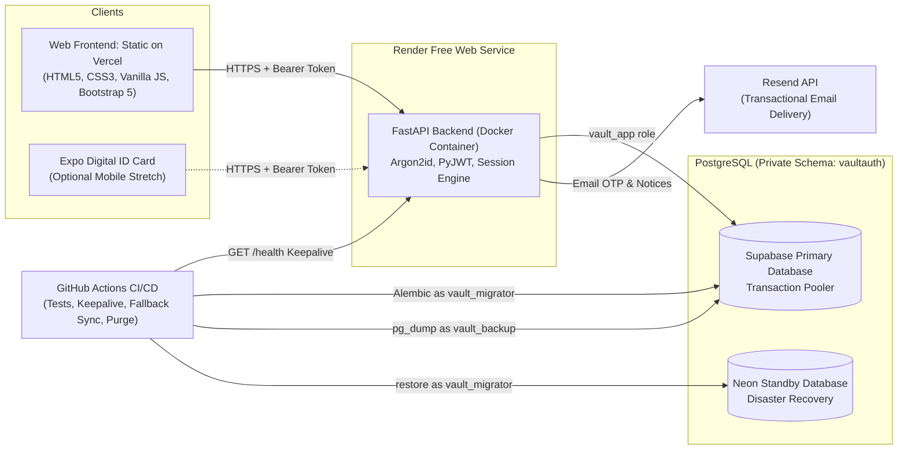
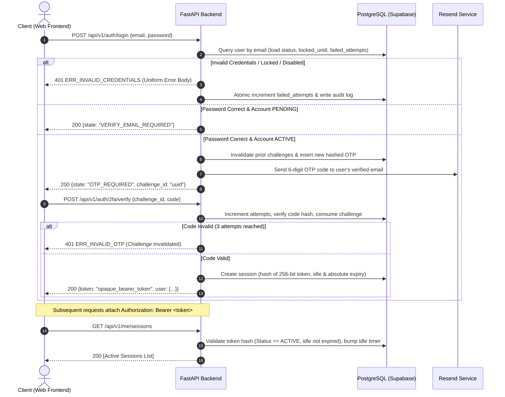
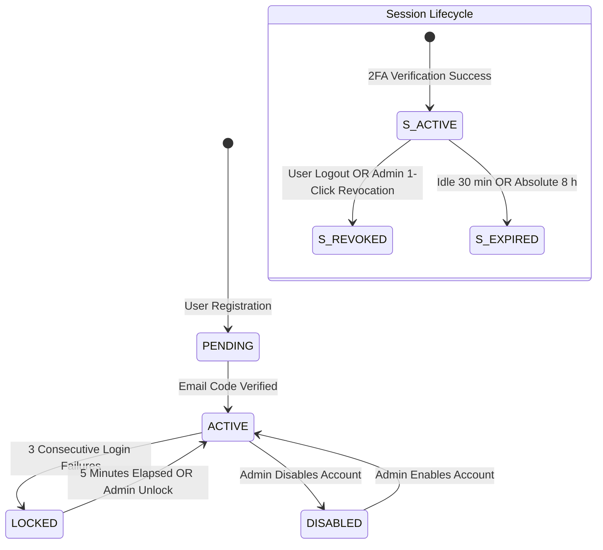

# PRD: VaultAuth SSO (v2.0 Optimized)

## 1. Header Information

| Field | Value |
| :--- | :--- |
| **Project** | **VaultAuth SSO** |
| **ID / Track** | `PST_PD_154` / Product development |
| **Batch / Level** | 2026 / Level 4 (Stretch) |
| **Duration** | 4 weeks (3 working weeks + 1 buffer week) |
| **Team Composition** | **2-Student Agile Engineering Team**<br>• **Shaurya Jain**: Backend + DevSecOps Lead ([vaultauth-backend](https://github.com/ProPlays2312/vaultauth-backend))<br>• **Apoorva Bhardwaj**: Frontend & Client Security Architecture Lead ([vaultauth-frontend](https://github.com/ABhardwaj28/vaultauth-frontend)) |
| **Course Mentor** | Mahati Ma'am |
| **PRD Version** | **v2.0, updated from v1.0** |
| **Status** | Decisions D1 to D20 approved. Items tagged `[Mentor review]` deviate from v1.0 and need mentor approval. |
| **Repositories** | • Frontend: `https://github.com/ABhardwaj28/vaultauth-frontend`<br>• Backend: `https://github.com/ProPlays2312/vaultauth-backend` |
| **Companion Documents** | `README.md`, `architecture.md`, `auth.md` (API contract and examples), `usersmapping.md`, `schema.md`, `tech.md`, `guide.md`. |

---

## 2. What Changed From v1.0 and Why

v1.0 was a client-only demo (`localStorage`, SHA-256 in the browser). That design cannot deliver its own success criteria: anyone can edit `localStorage` to become admin, a session cannot be revoked from another browser, and an unsalted fast hash is not a safe way to store passwords. v2.0 keeps the PRD's flows, screens, roles, and API shape, and moves the source of truth to a production-grade backend while elevating the frontend to an enterprise-grade client.

| # | v1.0 Design | v2.0 Design | Architectural Rationale | Status Tag |
| :-: | :--- | :--- | :--- | :--- |
| **1** | SHA-256 in browser (`SubtleCrypto`) | `argon2id` on the server; browser sends password over TLS only | SHA-256 is fast and unsalted by default, making it cheap to brute-force offline. Argon2id provides memory-hard protection. | `[Mentor review]` |
| **2** | `localStorage` + `sample-data.json` | PostgreSQL (Supabase primary, Neon fallback) | Roles, account locks, and session revocations are only tamper-proof if the server enforces them. | `[Mentor review]` |
| **3** | Mock OTP shown in a toast | Real OTP by email (Resend); optional TOTP upgrade | A passcode visible directly in the client UI does not constitute an authentic out-of-band second factor. | `[Mentor review]` |
| **4** | *"Invalid credentials. Attempt N/3."* & *"Account locked"* | One generic error (`ERR_INVALID_CREDENTIALS`) for all login failures | Granular error strings leak user existence and remaining brute-force attempts to attackers. | `[Mentor review]` |
| **5** | `ERR_DUPLICATE_EMAIL` on register | Generic *"Check your email"* response | Prevents user enumeration via the public registration endpoint. | `[Mentor review]` |
| **6** | No email ownership verification | Account state is `PENDING` until email verification code is confirmed | Prevents bad actors from burning daily email delivery quotas or spamming unverified victims. | `[Mentor review]` |
| **7** | Anyone can register as `admin` | Public registration creates `user` role only; admins promoted via CLI / existing admin | Self-service admin selection constitutes a critical privilege escalation flaw. | `[Mentor review]` |
| **8** | Lockout rule contradiction (5 min vs contact admin) | Auto-unlock after 5 min; manual admin unlock also supported | Reconciles both requirements safely into a cohesive policy. | Accepted |
| **9** | Reset-state button for both roles | CLI only (`reset`), run by backend student (D15). No HTTP reset endpoint | An HTTP endpoint that wipes production databases is a catastrophic vulnerability. | `[Mentor review]` |
| **10** | Account lock & session revocation were "Good to have" | Promoted to **Must-Have** core requirements | Essential to meeting the 30-second session revocation evaluation criteria. | Promoted |
| **11** | Ambiguous stack ("JavaScript/Python") | Python (FastAPI) backend + Vanilla JS & Bootstrap 5 frontend | Clean responsibility split across the 2-student engineering team. | Accepted |

---

## 3. Executive Overview

**VaultAuth SSO** is an enterprise email + password authentication and identity management portal built for **End Users (employees)** and **Enterprise Admins**. A valid primary password triggers an out-of-band second factor (a 6-digit code delivered via email, or a TOTP code if enrolled). Only upon successful verification does the backend issue a cryptographically random, opaque 256-bit Bearer session token. Administrators can inspect active sessions across all devices, revoke compromised sessions in 1-click, unlock accounts, and analyze immutable audit logs. Any revoked session is rejected on its very next HTTP request.

- **Industry:** Cybersecurity
- **Theme:** Identity & Access Management (Zero-Trust Architecture)
- **One-Line Pitch:** *"For enterprise teams seeking secure single sign-on without complex OAuth infrastructure, VaultAuth SSO provides argon2id-hashed credentials, email-verified 2FA, and active session revocation that takes effect on the next request."*
- **Optional Extensions:** 2-screen React Native (Expo Go) Corporate Digital ID Card companion app; reading-only WebAuthn/FIDO2 architectural concept card.

---

## 4. Problem Statement & Root Cause Analysis

Organizations frequently store credentials weakly, omit multi-factor authentication checks, and lack immediate kill-switches to sever compromised employee sessions.

### Concrete Pain Points
1. **Password Exposure:** Inadequate password hashing algorithms (e.g. cleartext, MD5, or unsalted SHA-256) expose corporate credentials to instant offline rainbow table and dictionary attacks.
2. **Session Hijacking:** When employees access applications from unmanaged devices or public networks, stolen session cookies linger indefinitely with no centralized revocation mechanism.
3. **Admin Helplessness:** Enterprise security teams are unable to instantly invalidate active tokens when an account compromise is detected.

### Remediated State (Solved When)
1. Passwords are saved exclusively as `argon2id` hashes on the backend; plaintext secrets are never written to disk or logs.
2. Valid primary credentials mandate a verified second factor before a session token is minted.
3. Active sessions appear in real time on an admin console, and any revoked session is rejected on its immediate next request (< 30 seconds end-to-end).

---

## 5. Users, Roles & RBAC Matrix

The platform strictly segregates capabilities between **End Users (Employees)** and **Enterprise Admins**:

| Capability | End User (Employee) | Enterprise Admin | Enforced By |
| :--- | :---: | :---: | :--- |
| **Register Account & Verify Email** | Yes | Yes (Admins seeded/promoted via CLI) | API + Database constraints |
| **Log in with Email + 2FA** | Yes | Yes | API (`/auth/login` + `/auth/2fa/verify`) |
| **Enroll TOTP Authenticator (Optional)** | Yes | Yes | API (`/me/totp/*`) |
| **View Own Sessions & Digital ID Card** | Yes | Yes | API (`/me/sessions`) |
| **Revoke Own Session / Log Out** | Yes | Yes | API (`DELETE /sessions/{id}`) |
| **Revoke Any Third-Party User Session** | **No (404/403)** | **Yes** | API + DB `sessions_self_actor` check |
| **View Global Security Audit Log** | **No (Hidden View)** | **Yes** | API (`GET /admin/audit-logs`) |
| **Unlock / Enable / Disable User Accounts** | **No** | **Yes** | API (`POST /admin/users/{id}/*`) |
| **Reset Demo State** | **CLI Only** | **CLI Only** | Backend CLI tool (`reset.py`) |

---

## 6. Scope & Cut List

### 6.1 Must Have (Graded — Never Cut)
* **Registration with Email Verification:** Email + password registration; account status set to `PENDING`; 6-digit email verification code with 10-minute expiry; 3 wrong guesses invalidate code.
* **Server-Side Argon2id Password Hashing:** OWASP-compliant memory-hard hashing on the FastAPI backend.
* **Primary Login with Generic Error Defense:** Verifies credentials; returns uniform 401 response on any failure (preventing timing and user-enumeration leaks).
* **Two-Factor Authentication (Email OTP):** Out-of-band 6-digit challenge code sent via Resend; 3 wrong attempts invalidate challenge and mandate re-login.
* **Opaque Session Tokens:** 256-bit high-entropy random Bearer tokens (only SHA-256 hash stored in PostgreSQL); 30-minute idle timeout and 8-hour absolute lifespan.
* **Session Revocation:** 1-click revocation by user (own sessions) and admin (any session); takes effect on immediate next request.
* **Account Lockout:** 3 consecutive password failures set account to `LOCKED` for 5 minutes with atomic counter updates; auto-unlocks after 5 minutes or upon admin unlock.
* **Enterprise Security Audit Log:** Immutable event logging (`LOGIN_SUCCESS`, `LOGIN_FAILURE`, `LOCKOUT`, `REVOCATION`, etc.) filterable by event type.
* **PostgreSQL Persistence:** Multi-role schema (`vault_app`, `vault_migrator`, `vault_backup`) hosted on Supabase.
* **Responsive Frontend Web Client:** Clean, accessible Bootstrap 5 UI hosted on Vercel with strict Content Security Policy headers.

### 6.2 Prioritized Cut List (First to Cut → Last to Cut)
1. **Expo Go Corporate Digital ID Card (Cut #1):** Lowest impact on core authentication and security objectives.
2. **TOTP Authenticator App Enrollment (Cut #2):** Email OTP already satisfies all MFA requirements.
3. **Neon Fallback Sync Job (Cut #3):** Kept as long as possible for disaster recovery redundancy; cut only if CI runtime exceeds limits.

### 6.3 Out of Scope
* Production SMS/carrier gateways (e.g. Twilio).
* External OAuth2/OIDC identity brokering (Okta, Auth0, Google).
* Physical YubiKey hardware parsing or real FIDO2 WebAuthn credential negotiation (WebAuthn remains a reading-only concept card).

---

## 7. Functional Requirements

| ID | Requirement Name | Priority | Specification & Acceptance Criteria |
| :--- | :--- | :---: | :--- |
| **FR-01** | **User Registration** | Must | Accepts email + password. Server hashes password with `argon2id`. Account initialized as `PENDING`. Returns uniform 200 message (*"Check your email"*). |
| **FR-02** | **Email Verification** | Must | 6-digit code, hashed at rest, 10-minute expiry. 3 wrong tries invalidate code. Resend capped at 3 times before 15-minute cooldown. Valid entry sets account to `ACTIVE`. |
| **FR-03** | **Primary Login Authentication** | Must | Verifies email + password. All failures (unknown email, bad password, locked, disabled) return identical 401 `ERR_INVALID_CREDENTIALS`. Correct password on `PENDING` account returns `VERIFY_EMAIL_REQUIRED`. |
| **FR-04** | **Two-Factor Authentication (2FA)** | Must | Valid password generates challenge and emails 6-digit OTP (or prompts for TOTP). Valid code issues 256-bit opaque Bearer token. 3 incorrect attempts invalidate challenge. |
| **FR-05** | **Session Lifecycle Management** | Must | Opaque token hash stored in DB. Enforces 30-minute idle expiry and 8-hour absolute expiry. Revocation marks session status `REVOKED` immediately. |
| **FR-06** | **Account Lockout** | Must | 3 consecutive password failures trigger `LOCKED` status for 300 seconds (5 minutes). Counter serialized via atomic DB update. Auto-unlocks after 5 minutes or via admin unlock. |
| **FR-07** | **Active Session Revocation** | Must | Users can list and revoke their own active sessions. Admins can view and revoke any user's session. Revoked token fails on immediate next API call with 401. |
| **FR-08** | **Security Audit Logging** | Must | Captures security events (timestamp, actor, target, event, IP, metadata). Accessible exclusively to Admins. All fields sanitized against XSS on display. |
| **FR-09** | **Admin User Management** | Should | Admins can unlock locked accounts, enable/disable accounts, and promote users. Disabling an account immediately revokes all of that user's active sessions. |
| **FR-10** | **Database Persistence** | Must | All state persists in PostgreSQL under private schema `vaultauth`. Survives API restarts and container rebuilds. |
| **FR-11** | **TOTP Enrollment (Optional)** | Could | User can scan QR code to register authenticator app; generates hashed recovery codes; replaces email OTP at login. |
| **FR-12** | **Fallback DB Sync (Redundancy)** | Should | Scheduled CI job dumps tables via `vault_backup` and restores to Neon standby via `vault_migrator`. |
| **FR-13** | **Expo Digital ID Companion (Stretch)**| Could | 2-screen mobile app consuming the same backend API to list and revoke sessions. |

---

## 8. System Architecture

### 8.1 Topology Diagram



### 8.2 Sequence Diagram: Authentication & 2FA Flow



### 8.3 Account & Session State Machines



---

## 9. Frontend Architecture & Client Engineering (Optimized)

### 9.1 Single-Page Application (SPA) View State Architecture
The frontend is engineered as a lightweight, modular Vanilla JavaScript Single Page Application with clean hash-based routing (`#/login`, `#/register`, `#/verify-email`, `#/2fa`, `#/dashboard`, `#/admin`, `#/concept/webauthn`):

```
vaultauth-frontend/
├── index.html                # Semantic HTML5 entrypoint with view containers
├── vercel.json               # Production CSP, SRI, and security response headers
├── css/
│   └── style.css             # Cybersecurity dark-mode theme, glowing status pills, OTP boxes
├── js/
│   ├── app.js                # Core state router & view coordinator
│   ├── api.js                # Asynchronous API client with dual-mode adapter
│   ├── auth.js               # Auth workflows, token lifecycle, and session guard
│   ├── ui.js                 # DOM manipulators, spinners, modals, toasts
│   └── components/
│       ├── otpInput.js       # Auto-advancing split 6-digit numeric input
│       ├── countdownTimer.js # Visual countdown ring for OTP expiry & lockout
│       ├── sessionTable.js   # Active session manager with 1-click revocation buttons
│       └── auditTable.js     # Admin audit log explorer with event filter
└── docs/
    ├── PRD_v2.0.md           # This document
    └── VaultAuth_SSO_PRD_v2.0.pdf
```

### 9.2 Key Frontend Optimizations & UX Enhancements

1. **Split 6-Digit OTP Box Component (`otpInput.js`):**
   - Renders 6 distinct numeric input elements.
   - Automatically advances focus upon digit entry and reverses focus on backspace.
   - Intercepts clipboard paste events (e.g. pasting `"849201"` instantly populates all 6 inputs and triggers validation).
   - Enforces `inputmode="numeric"` and `pattern="[0-9]*"` for mobile virtual keyboards.

2. **Render Cold-Start & Latency Defense:**
   - Free-tier server containers sleep after 15 minutes of inactivity and require ~50 seconds to wake up.
   - When any API call takes longer than 2.0 seconds, the client UI automatically displays an elegant, non-blocking notification toast:
     > ⏳ *VaultAuth secure cloud service is initializing (waking up container)... Please wait.*
   - Disables submit buttons and renders inline spinners to prevent impatient double-submissions.

3. **Client-Side Secret & Token Hygiene (Zero Exposure):**
   - **Zero Plaintext Ingestion:** Password fields are passed directly to `fetch()` over HTTPS/TLS and never logged or written to `localStorage`.
   - **Ephemeral In-Memory / `sessionStorage`:** Opaque Bearer tokens are kept in memory and synchronized to `sessionStorage` (cleared on browser tab close). Tokens are purged instantly upon clicking "Sign Out" or upon receiving any HTTP 401 response.

4. **Defense-in-Depth XSS Sanitization:**
   - Strict rule: Dynamic server-provided strings (emails, device user-agents, IP addresses, audit event descriptions) must **never** be rendered via `innerHTML`.
   - All table cells and text elements are rendered using standard `element.textContent` and `document.createElement()`, neutralizing HTML/script injection vectors.

5. **Production Content Security Policy (`vercel.json`):**
   ```json
   {
     "headers": [
       {
         "source": "/(.*)",
         "headers": [
           { "key": "Content-Security-Policy", "value": "default-src 'self'; script-src 'self'; style-src 'self' https://cdn.jsdelivr.net; font-src 'self' https://cdn.jsdelivr.net; connect-src 'self' https://*.onrender.com; frame-ancestors 'none'; base-uri 'none';" },
           { "key": "X-Frame-Options", "value": "DENY" },
           { "key": "X-Content-Type-Options", "value": "nosniff" },
           { "key": "Referrer-Policy", "value": "strict-origin-when-cross-origin" },
           { "key": "Permissions-Policy", "value": "camera=(), microphone=(), geolocation=()" }
         ]
       }
     ]
   }
   ```

6. **Interactive WebAuthn/FIDO2 Architecture Card:**
   - Dedicated reading-only modal highlighting FIDO2/WebAuthn public-key authentication, challenge-response mechanisms, and biometric integration to fulfill stretch learning goals.

---

## 10. Database Schema & Invariants (PostgreSQL 15+)

All application tables reside within the private schema `vaultauth`.

```sql
CREATE SCHEMA vaultauth;

CREATE TABLE vaultauth.users (
    id uuid PRIMARY KEY DEFAULT gen_random_uuid(),
    email text NOT NULL,
    password_hash text NOT NULL,
    role text NOT NULL DEFAULT 'user',
    status text NOT NULL DEFAULT 'PENDING',
    failed_attempts smallint NOT NULL DEFAULT 0,
    locked_until timestamptz,
    totp_secret_enc bytea,
    totp_enabled boolean NOT NULL DEFAULT false,
    created_at timestamptz NOT NULL DEFAULT now(),
    updated_at timestamptz NOT NULL DEFAULT now(),
    CONSTRAINT users_email_norm CHECK (email = lower(btrim(email)) AND length(email) BETWEEN 3 AND 254),
    CONSTRAINT users_hash_argon2 CHECK (password_hash LIKE '$argon2id$%'),
    CONSTRAINT users_role CHECK (role IN ('user','admin')),
    CONSTRAINT users_status CHECK (status IN ('PENDING','ACTIVE','LOCKED','DISABLED')),
    CONSTRAINT users_failed_range CHECK (failed_attempts BETWEEN 0 AND 100),
    CONSTRAINT users_lock_has_ts CHECK (status <> 'LOCKED' OR locked_until IS NOT NULL),
    CONSTRAINT users_totp_has_key CHECK (NOT totp_enabled OR totp_secret_enc IS NOT NULL)
);
CREATE UNIQUE INDEX users_email_uq ON vaultauth.users (email);

CREATE TABLE vaultauth.otp_challenges (
    id uuid PRIMARY KEY DEFAULT gen_random_uuid(),
    user_id uuid NOT NULL REFERENCES vaultauth.users(id) ON DELETE CASCADE,
    purpose text NOT NULL,
    code_hash text NOT NULL,
    attempts smallint NOT NULL DEFAULT 0,
    expires_at timestamptz NOT NULL,
    consumed_at timestamptz,
    invalidated_at timestamptz,
    created_at timestamptz NOT NULL DEFAULT now(),
    CONSTRAINT otp_purpose CHECK (purpose IN ('EMAIL_VERIFY','LOGIN_EMAIL','LOGIN_TOTP')),
    CONSTRAINT otp_attempts CHECK (attempts BETWEEN 0 AND 3),
    CONSTRAINT otp_exp_after CHECK (expires_at > created_at),
    CONSTRAINT otp_one_end CHECK (NOT (consumed_at IS NOT NULL AND invalidated_at IS NOT NULL)),
    CONSTRAINT otp_user_id_uq UNIQUE (user_id, id)
);
CREATE INDEX otp_expires ON vaultauth.otp_challenges (expires_at);
CREATE UNIQUE INDEX otp_one_live ON vaultauth.otp_challenges (user_id, purpose)
    WHERE consumed_at IS NULL AND invalidated_at IS NULL;

CREATE TABLE vaultauth.sessions (
    id uuid PRIMARY KEY DEFAULT gen_random_uuid(),
    user_id uuid NOT NULL REFERENCES vaultauth.users(id) ON DELETE CASCADE,
    challenge_id uuid NOT NULL,
    token_hash char(64) NOT NULL,
    device text NOT NULL DEFAULT 'unknown',
    ip inet,
    status text NOT NULL DEFAULT 'ACTIVE',
    created_at timestamptz NOT NULL DEFAULT now(),
    last_seen_at timestamptz NOT NULL DEFAULT now(),
    idle_expires_at timestamptz NOT NULL,
    absolute_expires_at timestamptz NOT NULL,
    revoked_at timestamptz,
    revoked_by uuid REFERENCES vaultauth.users(id),
    revoke_reason text,
    CONSTRAINT sessions_status CHECK (status IN ('ACTIVE','REVOKED','EXPIRED')),
    CONSTRAINT sessions_tok_hex CHECK (token_hash ~ '^[0-9a-f]{64}$'),
    CONSTRAINT sessions_revoked_ts CHECK ((status = 'REVOKED') = (revoked_at IS NOT NULL)),
    CONSTRAINT sessions_revoked_reason CHECK ((status = 'REVOKED') = (revoke_reason IS NOT NULL)),
    CONSTRAINT sessions_reason_vals CHECK (revoke_reason IS NULL OR revoke_reason IN ('SELF','ADMIN','SYSTEM')),
    CONSTRAINT sessions_reason_actor CHECK (revoke_reason IS NULL OR ((revoke_reason = 'SYSTEM') = (revoked_by IS NULL))),
    CONSTRAINT sessions_self_actor CHECK (revoke_reason IS DISTINCT FROM 'SELF' OR revoked_by = user_id),
    CONSTRAINT sessions_abs_gt CHECK (absolute_expires_at > created_at),
    CONSTRAINT sessions_idle_le CHECK (idle_expires_at <= absolute_expires_at),
    CONSTRAINT sessions_challenge_same_user FOREIGN KEY (user_id, challenge_id) REFERENCES vaultauth.otp_challenges (user_id, id)
);
CREATE UNIQUE INDEX sessions_token_uq ON vaultauth.sessions (token_hash);
CREATE INDEX sessions_user_status ON vaultauth.sessions (user_id, status);
CREATE INDEX sessions_active_created ON vaultauth.sessions (created_at DESC) WHERE status = 'ACTIVE';
CREATE INDEX sessions_abs_exp ON vaultauth.sessions (absolute_expires_at);

CREATE TABLE vaultauth.audit_logs (
    id bigserial PRIMARY KEY,
    ts timestamptz NOT NULL DEFAULT now(),
    event text NOT NULL,
    actor_user_id uuid REFERENCES vaultauth.users(id) ON DELETE SET NULL,
    target_user_id uuid REFERENCES vaultauth.users(id) ON DELETE SET NULL,
    ip inet,
    details jsonb NOT NULL DEFAULT '{}',
    CONSTRAINT audit_event CHECK (event ~ '^[A-Z0-9_]{3,64}$')
);
CREATE INDEX audit_ts ON vaultauth.audit_logs (ts DESC);
CREATE INDEX audit_event ON vaultauth.audit_logs (event, ts DESC);
CREATE INDEX audit_target ON vaultauth.audit_logs (target_user_id, ts DESC);
```

---

## 11. RESTful API Contract

All endpoints use base path `/api/v1`. All request/response bodies are JSON. Errors follow the standard envelope:
```json
{
  "error": {
    "code": "ERR_STRING",
    "message": "Human-readable description",
    "request_id": "req_uuid"
  }
}
```

### 11.1 Endpoints Specification

| Method & Route | Access | Purpose | Key Parameters / Request Body | Expected Response |
| :--- | :--- | :--- | :--- | :--- |
| `POST /auth/register` | Open (rate-limited) | Register account | `{ "email": "...", "password": "..." }` | `200 { "message": "Check your email for confirmation code" }` |
| `POST /auth/verify-email` | Open (rate-limited) | Verify registration | `{ "email": "...", "code": "123456" }` | `200 { "message": "Email verified. You may now log in." }` |
| `POST /auth/verify-email/resend` | Open (capped at 3) | Resend verify code | `{ "email": "..." }` | `200 { "message": "Verification code resent." }` |
| `POST /auth/login` | Open (rate-limited) | Primary password check | `{ "email": "...", "password": "..." }` | `200 { "state": "OTP_REQUIRED", "challenge_id": "..." }` |
| `POST /auth/2fa/verify` | Open (with challenge) | Validate OTP code | `{ "challenge_id": "...", "code": "123456" }`| `200 { "token": "256bit_hex_token", "user": { ... } }` |
| `POST /auth/logout` | Authenticated | Invalidate current session| Header `Authorization: Bearer <token>` | `200 { "message": "Logged out successfully" }` |
| `GET /me` | Authenticated | Own profile data | Header `Authorization: Bearer <token>` | `200 { "id": "...", "email": "...", "role": "user" }` |
| `GET /me/sessions` | Authenticated | List own active sessions | Header `Authorization: Bearer <token>` | `200 [ { "id": "...", "device": "...", "ip": "...", "created_at": "..." } ]` |
| `DELETE /sessions/{id}` | Authenticated | Revoke session | Path param `id` (own session, or admin)| `200 { "message": "Session revoked" }` |
| `GET /admin/sessions` | Admin Only | List all active sessions | Header `Authorization: Bearer <token>` | `200 [ { "id": "...", "user_email": "...", "device": "...", "ip": "..." } ]` |
| `GET /admin/audit-logs` | Admin Only | Inspect audit trail | Query: `?event=LOGIN_FAILURE&limit=50` | `200 [ { "id": 1, "ts": "...", "event": "...", "ip": "..." } ]` |
| `POST /admin/users/{id}/unlock`| Admin Only | Unlock locked user | Path param `id` | `200 { "message": "User unlocked" }` |
| `GET /health` | Open | Health check / keepalive | None | `200 { "status": "ok", "db": "healthy" }` |

---

## 12. Business Rules & Operational Policies

* **BR-01 (Zero Cleartext Password Storage):** Passwords are never stored, logged, or returned. Only `argon2id` hashes exist in the database. Logs never contain tokens, OTPs, or hashes.
* **BR-02 (Mandatory 2FA Gate):** A correct password never directly creates an active session. Only a verified second factor (email OTP or TOTP) mints an active token.
* **BR-03 (3-Strike Account Lockout):** 3 consecutive invalid passwords trigger a `LOCKED` status for exactly 300 seconds (5 minutes). Counter updates are serialized via atomic SQL statements. Auto-unlocks after 5 minutes.
* **BR-04 (Session Revocation Boundary):** End Users can only revoke their own active sessions. Enterprise Admins can revoke any user's session.
* **BR-05 (Generic Error Privacy):** No client-visible error message may reveal whether an email exists, is locked, or how many login attempts remain.
* **BR-06 (Opaque Session Tokens):** Session tokens are random 256-bit cryptographic values. Only the SHA-256 hash of the token is stored in the database.
* **BR-07 (Failover Protection):** Manual failover to the standby database terminates all active sessions (reason: `SYSTEM`) to guarantee consistency.
* **BR-08 (Data Retention & Purge):** Audit logs and expired/revoked sessions older than 30 days are purged in small batches via scheduled cron jobs.
* **BR-09 (Least Privilege Public Registration):** Public self-registration strictly assigns the `user` role.
* **BR-10 (Admin Authority Isolation):** Admin rights are granted exclusively via CLI (`promote-admin`) or by an existing admin. Account locking blocks future login attempts only; it never terminates live sessions (preventing denial-of-service against legitimate users). Account disabling immediately terminates all live sessions.
* **BR-11 (Database Role Boundary):** The FastAPI web application connects strictly under the restricted `vault_app` role and refuses to start if given superuser or DDL privileges.

---

## 13. Milestones & 4-Week Delivery Roadmap

| Week | Backend & DevSecOps Deliverables (Shaurya Jain) | Frontend & Security Architecture (Apoorva Bhardwaj) |
| :---: | :--- | :--- |
| **Week 1** | • Git repository setup (`vaultauth-backend`).<br>• Alembic migrations & PostgreSQL schema implementation.<br>• Argon2id hashing integration & `/auth/register`.<br>• OpenAPI spec generation & CI test pipeline setup. | • Git repository setup (`vaultauth-frontend`).<br>• Responsive Bootstrap 5 layout & cyber theme.<br>• Client SPA router & view containers.<br>• Dual-mode `api.js` client adapter & registration view. |
| **Week 2** | • Out-of-band email OTP via Resend.<br>• Opaque 256-bit session token minting.<br>• Primary login authentication & generic error contract.<br>• 3-strike account lockout atomic DB logic. | • Split 6-digit auto-advancing OTP input component.<br>• Email verification & login views.<br>• Ephemeral session token storage (`sessionStorage`).<br>• Countdown timers for OTP expiry and account lockout. |
| **Week 3** | • Session revocation endpoints (`DELETE /sessions/{id}`).<br>• Admin endpoints (`/admin/sessions`, `/admin/audit-logs`).<br>• 30-day retention purge & CI keepalive ping.<br>• Standby database sync job & Render deployment. | • User Dashboard with Corporate Digital ID Card view.<br>• Admin Console with real-time session kill-switch table.<br>• Security audit log table with XSS sanitization.<br>• Vercel deployment with production CSP security headers. |
| **Week 4 (Buffer)**| • Automated failover drill & recovery test.<br>• Complete CI test suite verification.<br>• Final security audit & backend documentation. | • Cross-browser verification (Chrome, Safari, Firefox).<br>• Mobile responsive polish & viewport testing (375px).<br>• WebAuthn reading-only concept modal.<br>• Final demonstration walkthrough video recording. |

---

## 14. Deliverables & Repository Ecosystem

1. **Frontend Repository:** [https://github.com/ABhardwaj28/vaultauth-frontend](https://github.com/ABhardwaj28/vaultauth-frontend)
2. **Backend Repository:** [https://github.com/ProPlays2312/vaultauth-backend](https://github.com/ProPlays2312/vaultauth-backend)
3. **Deployed Web Client:** Hosted on Vercel with enterprise CSP response headers.
4. **Deployed API Service:** Containerized FastAPI on Render free tier.
5. **Database Infrastructure:** PostgreSQL 15+ on Supabase (Primary) and Neon (Standby).
6. **Documentation:** This optimized PRD (v2.0), comprehensive READMEs, and OpenAPI specification.

---

## 15. Sign-off & Approvals

| Role | Name | Status |
| :--- | :--- | :---: |
| **Backend & DevSecOps Lead** | Shaurya Jain | **[Approved]** |
| **Frontend & Client Security Lead**| Apoorva Bhardwaj | **[Approved]** |
| **Course Mentor** | Mahati Ma'am | **[Pending Review]** |
